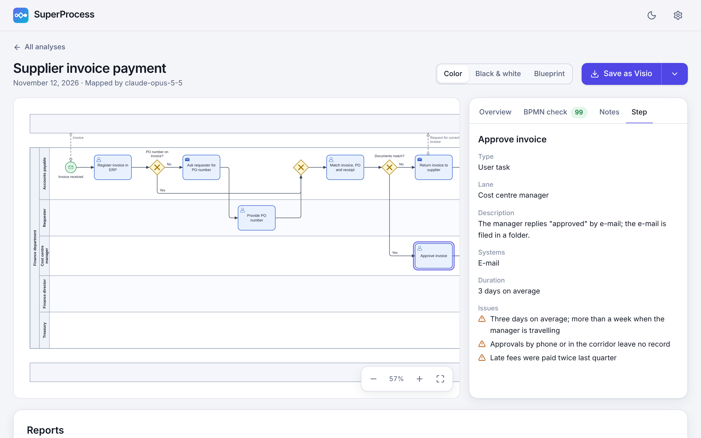
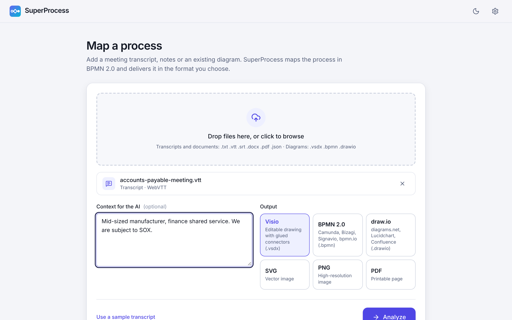
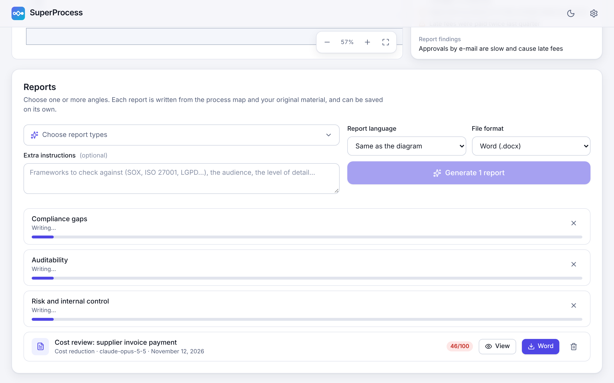
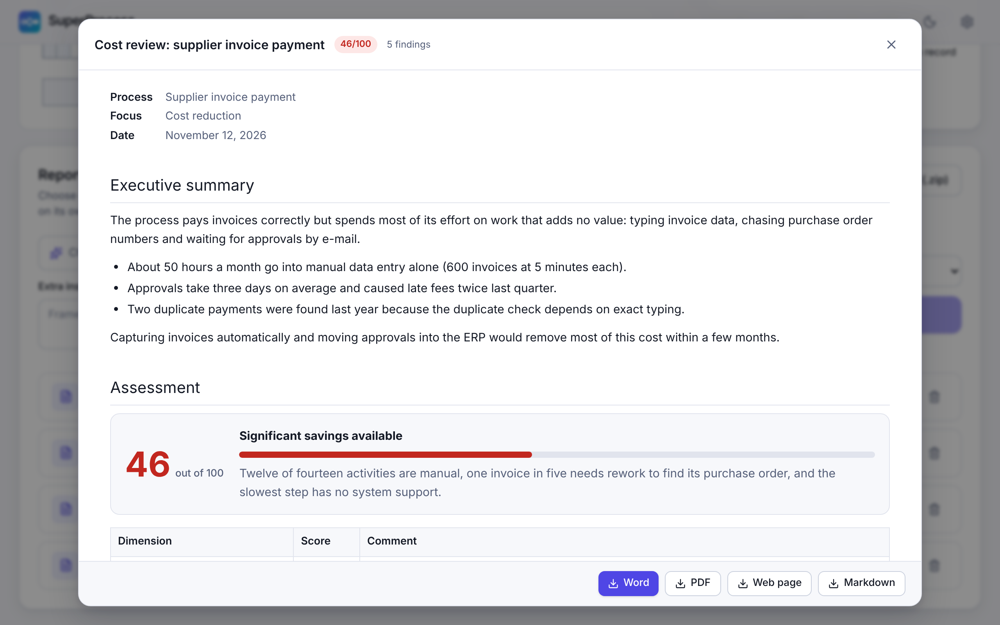
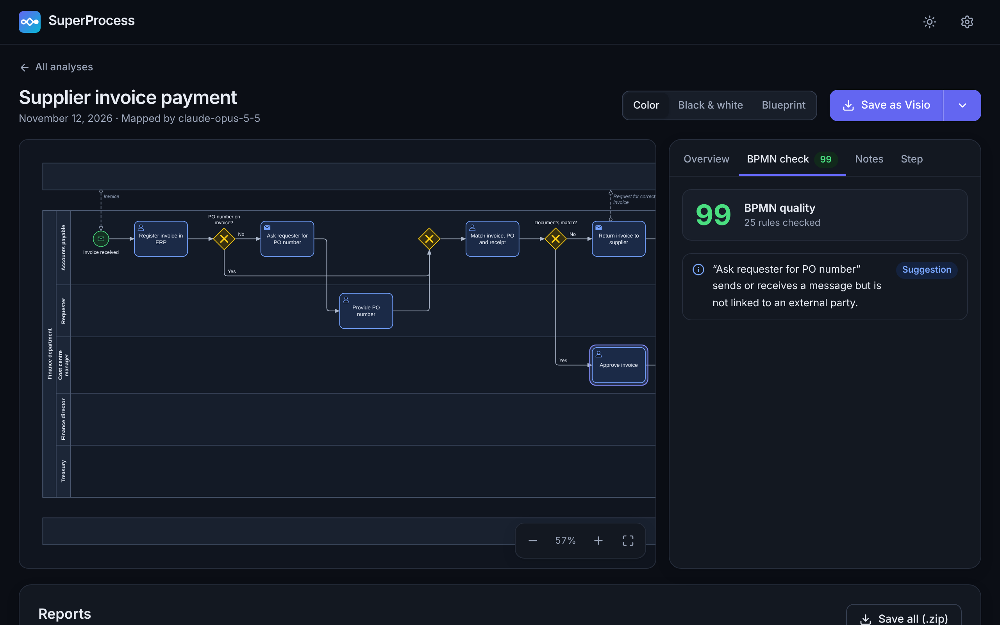

<p align="center">
  
</p>
<h1 align="center">SuperProcess</h1>
<p align="center">
  Turn meeting transcripts and existing diagrams into clean BPMN 2.0 process maps<br>
  and AI-written reports on cost, compliance, auditability, risk and more.
</p>
<p align="center">
  <a href="README.pt-BR.md">Português</a>
</p>



## What it does

1. **You add material.** A transcript of the meeting where people explained how the work is done (`.vtt`, `.srt`, `.txt`, `.docx`, `.pdf`, speech-to-text `.json`), an existing diagram (`.vsdx`, `.bpmn`, `.drawio`), or both.
2. **An AI maps the process.** It reads everything, reconstructs the process as it runs today and writes it as a BPMN 2.0 model: lanes, tasks, gateways, events, external parties and message flows, with the systems, documents, durations and pain points mentioned for each step.
3. **SuperProcess checks and draws it.** The model is checked against 25 BPMN rules, corrected where needed, and laid out automatically with swimlanes and orthogonal flows.
4. **You save it** as Visio, BPMN 2.0, draw.io, SVG, PNG or PDF.
5. **You ask for reports.** Pick one or several angles (cost reduction, compliance gaps, auditability, risk and control, data protection, automation and 12 more, or describe your own). The reports are written in parallel and saved as Word, PDF, HTML or Markdown.

| | |
|---|---|
|  |  |
|  |  |

## Use it

**In the browser.** Nothing to install. Once GitHub Pages is enabled for this repository (see [Deploying](#deploying)), the app is served at `https://malonefreak.github.io/SuperProcess/`. It can be installed from the browser's address bar as an app that also works offline.

**As a desktop app.** Download the installer or the portable version for Windows, macOS or Linux from the [Releases](../../releases) page, when a release has been published. The desktop app connects to local AI servers without any extra configuration.

**From source.**

```bash
git clone https://github.com/MaloneFreak/SuperProcess.git
```

```bash
cd SuperProcess && npm install
```

```bash
npm run dev
```

On first run, SuperProcess asks for a language and an AI connection. You can skip the AI and explore the built-in sample process first.

## Choosing an AI

SuperProcess has no server of its own. Your files go from your device straight to the AI you choose.

### Cloud

| Provider | Notes |
|---|---|
| **Anthropic Claude** (recommended) | `claude-opus-5-5` by default; Fable 5.2, Sonnet 5.5 and Haiku 5.5 can be selected. Uses structured output, adaptive thinking and prompt caching: when several reports are generated, the sources are sent once and read from the cache by the others. |
| OpenAI, Google Gemini, OpenRouter | The model list is read from your account. |
| Any OpenAI-compatible endpoint | Give its address and, if needed, a key. |

You need an API key from the provider; usage is billed by them.

### Local (private, free)

Install [Ollama](https://ollama.com/download) and SuperProcess will detect it, list the models you have and download new ones for you, with progress. LM Studio works through its local server.

A starting point by available memory (any model in your Ollama library can be used):

| Memory | Models |
|---|---|
| 8 GB | `qwen3:4b`, `gemma3:4b` |
| 16 GB | `qwen3:8b`, `gemma3:12b`, `qwen3:14b` |
| 24–32 GB | `gpt-oss:20b`, `gemma3:27b`, `qwen3:32b` |

Bigger models map processes more accurately and write better reports. Long transcripts that do not fit a local model's context window are condensed into process notes first, part by part; nothing is cut silently.

> Using the web app with Ollama? Ollama only answers sites it trusts. Set the environment variable `OLLAMA_ORIGINS` to the address of the site (for example `https://malonefreak.github.io`) and restart Ollama. The desktop app does not need this.

## Files

| Input | Formats |
|---|---|
| Transcripts | WebVTT (Teams, Zoom, Meet), SubRip, plain text, Markdown, JSON from Whisper, WhisperX, AssemblyAI, Deepgram and AWS Transcribe |
| Documents | Word (`.docx`), PDF (with a text layer), HTML |
| Diagrams | Visio (`.vsdx`, `.vsdm`), BPMN 2.0 (`.bpmn`), draw.io (`.drawio`), Mermaid, PlantUML |

| Output | What you get |
|---|---|
| Visio `.vsdx` | Editable shapes, connectors glued to their shapes, pools and lanes as groups, and Shape Data on every step (type, lane, systems, inputs, outputs, duration, issues) |
| BPMN 2.0 `.bpmn` | Semantic model and diagram layout for Camunda, Bizagi, Signavio, bpmn.io and other BPMN tools |
| draw.io `.drawio` | Native BPMN shapes inside real swimlane containers; also opens in Lucidchart and Confluence |
| SVG, PNG, PDF | The diagram as an image or a printable page |
| Reports | Word, PDF, HTML or Markdown, with the process map highlighting the steps that have findings |

## Reports

Each report contains an executive summary, a score with its breakdown, key figures, findings with severity, evidence quoted from your material, impact and recommendation, the analysis tables that belong to the angle (a risk and control matrix, a RACI matrix, a KPI catalogue, …), an action plan and the open questions.

| Efficiency and cost | Governance, risk and compliance | Quality and experience | Organisation and systems | Documentation and strategy |
|---|---|---|---|---|
| Cost reduction | Compliance gaps | Quality and error-proofing | Roles and responsibilities (RACI) | Process documentation (SOP) |
| Lean waste analysis | Auditability | Customer experience | Systems and data | Executive overview |
| Bottlenecks and lead time | Risk and internal control | | KPIs and measurement | Redesign proposal (to-be) |
| Automation and AI opportunities | Data protection (LGPD / GDPR) | | Process maturity | |
| | Continuity and resilience | | | |

A **custom focus** lets you describe any other angle in your own words. Reports can be written in a language different from the diagram's.

## BPMN quality check

Every model is checked for errors (missing start or end events, dead ends, unreachable steps, misused events), for violations of modelling conventions (gateways that split and merge at once, unlabelled decisions, implicit splits) and for readability. The result is a score and a list you can click through; corrections applied automatically are listed as well.

## Privacy

- Analyses, settings and API keys are stored only on your device (browser storage).
- Your files are sent only to the AI provider you configured. With a local model they never leave your computer.
- There is no telemetry and no account.

## Languages

The interface is available in English, Português (Brasil) and Español. Diagrams and reports can be produced in 13 languages, or follow the language of the source material. To add an interface language, copy `src/i18n/locales/en.json`, translate it and register it in `src/i18n/index.ts` and `src/state/settings.ts`.

## Development

```bash
npm run dev
```

```bash
npm test
```

```bash
npm run build && npm run e2e
```

```bash
npm run desktop
```

| Path | Contents |
|---|---|
| `src/core/model` | The process model, the normaliser that repairs AI output, the BPMN rule checker |
| `src/core/layout` | Swimlane-aware automatic layout and orthogonal routing |
| `src/core/render` | BPMN symbols and the SVG renderer |
| `src/core/export`, `src/core/import` | Readers and writers for every file format |
| `src/core/report` | Report angles, report structure and its writers |
| `src/ai` | Providers (Claude through the official SDK, OpenAI-compatible, Ollama), prompts and the analysis pipeline |
| `src/ui`, `src/state` | The React interface and its state |
| `electron` | The desktop shell |
| `tests`, `e2e` | Unit tests and browser tests |

The unit tests cover the model, the layout (no overlapping shapes, no flow through a shape), round trips through every file format and the AI layer against scripted responses. The end-to-end tests drive the built app in a real browser.

## Deploying

**Web app.** In the repository settings, open *Pages* and choose *GitHub Actions* as the source. The `Deploy the web app to GitHub Pages` workflow then publishes every push to `main`.

**Desktop apps.** Push a tag such as `v0.1.0`. The `Build the desktop apps` workflow builds a Windows installer and portable `.exe`, macOS `.dmg` files and a Linux AppImage and `.deb`, and attaches them to a draft release. The builds are not code-signed, so Windows SmartScreen and macOS Gatekeeper warn on first launch.

## Status

SuperProcess is new. What has and has not been verified:

- The Visio writer is tested by reading its files back and by opening them in LibreOffice Draw. It has not yet been opened in Microsoft Visio itself; if Visio reports a problem, please open an issue with the file.
- The draw.io writer is tested by reading its files back, not in draw.io itself.
- The desktop app has been built and run on Linux. The Windows and macOS builds are produced by the release workflow and have not been run yet.
- AI providers are tested against scripted responses that follow their documented protocols, not against the live services.
- PDF reports use a font that covers Latin, Cyrillic and Greek. For other scripts, use Word or HTML.
- Legacy `.vsd` files must be saved as `.vsdx` first. Audio is not transcribed: add the transcript.

## License

[MIT](LICENSE)
