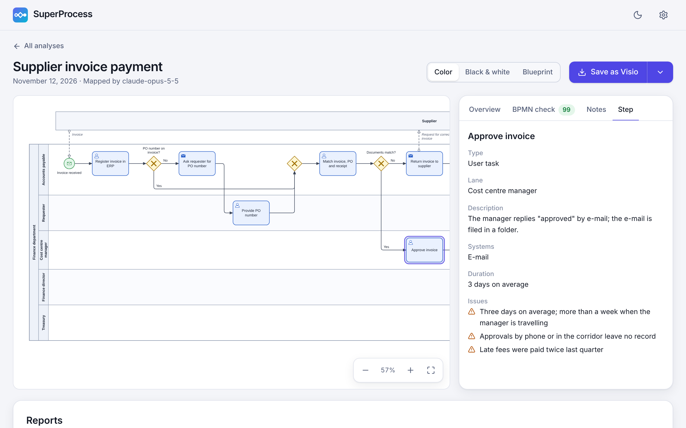
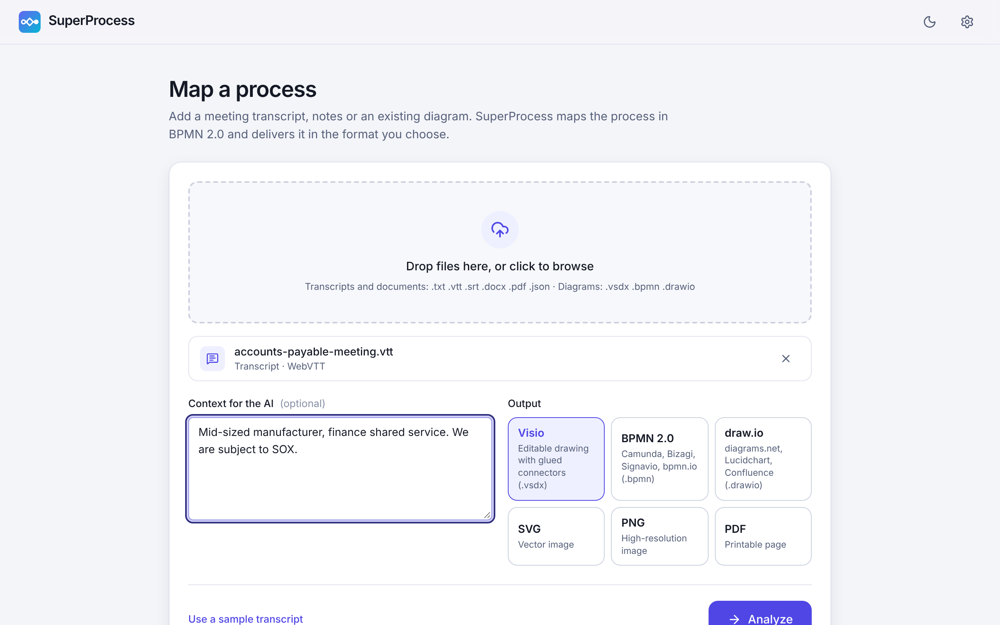
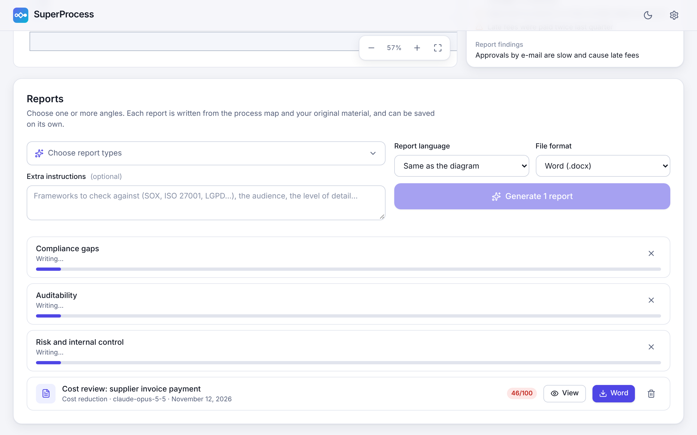
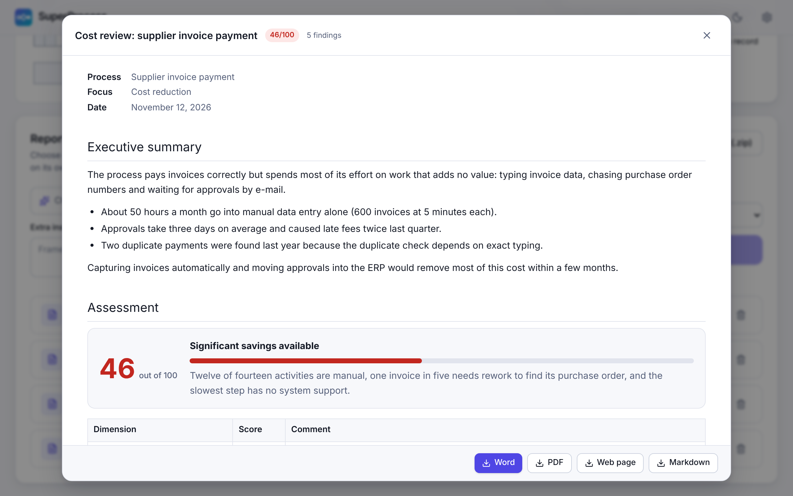
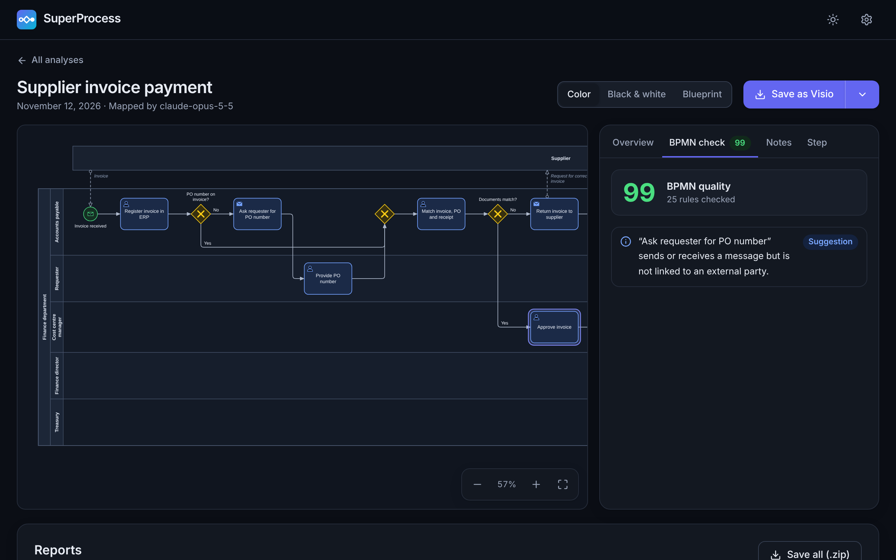

<p align="center">
  
</p>
<h1 align="center">SuperProcess</h1>
<p align="center">
  Transforme transcrições de reuniões e diagramas existentes em mapas de processo BPMN 2.0 bem formatados<br>
  e em relatórios escritos por IA sobre custos, compliance, auditabilidade, riscos e mais.
</p>
<p align="center">
  <a href="README.md">English</a>
</p>



## O que ele faz

1. **Você adiciona o material.** A transcrição da reunião em que as pessoas explicaram como o trabalho é feito (`.vtt`, `.srt`, `.txt`, `.docx`, `.pdf`, `.json` de ferramentas de transcrição), um diagrama existente (`.vsdx`, `.bpmn`, `.drawio`) ou os dois.
2. **Uma IA mapeia o processo.** Ela lê tudo, reconstrói o processo como ele funciona hoje e o escreve como um modelo BPMN 2.0: raias, tarefas, gateways, eventos, participantes externos e fluxos de mensagem, com os sistemas, documentos, prazos e problemas citados em cada etapa.
3. **O SuperProcess confere e desenha.** O modelo é verificado contra 25 regras BPMN, corrigido quando necessário e diagramado automaticamente, com raias e fluxos ortogonais.
4. **Você salva** em Visio, BPMN 2.0, draw.io, SVG, PNG ou PDF.
5. **Você pede relatórios.** Escolha um ou vários focos (redução de custos, lacunas de compliance, auditabilidade, riscos e controles, proteção de dados, automação e mais 12, ou descreva o seu). Os relatórios são escritos em paralelo e salvos em Word, PDF, HTML ou Markdown.

| | |
|---|---|
|  |  |
|  |  |

## Como usar

**No navegador.** Sem instalar nada. Depois de ativar o GitHub Pages neste repositório (veja [Publicação](#publicação)), o app fica em `https://malonefreak.github.io/SuperProcess/`. Ele pode ser instalado pela barra de endereços do navegador como um aplicativo que também funciona offline.

**Como programa de desktop.** Baixe o instalador ou a versão portátil para Windows, macOS ou Linux na página de [Releases](../../releases), quando houver uma versão publicada. O app de desktop se conecta a servidores locais de IA sem configuração extra.

**A partir do código-fonte.**

```bash
git clone https://github.com/MaloneFreak/SuperProcess.git
```

```bash
cd SuperProcess && npm install
```

```bash
npm run dev
```

Na primeira execução, o SuperProcess pergunta o idioma e a conexão com a IA. Dá para pular a IA e explorar primeiro o processo de exemplo que já vem no app.

## Escolhendo a IA

O SuperProcess não tem servidor próprio. Os seus arquivos vão do seu dispositivo direto para a IA que você escolher.

### Nuvem

| Provedor | Observações |
|---|---|
| **Anthropic Claude** (recomendado) | `claude-opus-5-5` por padrão; Fable 5.2, Sonnet 5.5 e Haiku 5.5 também podem ser escolhidos. Usa saída estruturada, raciocínio adaptativo e cache de prompt: ao gerar vários relatórios, as fontes são enviadas uma vez e lidas do cache pelos demais. |
| OpenAI, Google Gemini, OpenRouter | A lista de modelos é lida da sua conta. |
| Qualquer endpoint compatível com a OpenAI | Informe o endereço e, se preciso, uma chave. |

É necessária uma chave de API do provedor; o uso é cobrado por ele.

### Local (privado e gratuito)

Instale o [Ollama](https://ollama.com/download) e o SuperProcess o detecta, lista os modelos que você tem e baixa novos para você, com barra de progresso. O LM Studio funciona pelo servidor local dele.

Um ponto de partida conforme a memória disponível (qualquer modelo da sua biblioteca do Ollama pode ser usado):

| Memória | Modelos |
|---|---|
| 8 GB | `qwen3:4b`, `gemma3:4b` |
| 16 GB | `qwen3:8b`, `gemma3:12b`, `qwen3:14b` |
| 24–32 GB | `gpt-oss:20b`, `gemma3:27b`, `qwen3:32b` |

Modelos maiores mapeiam processos com mais precisão e escrevem relatórios melhores. Transcrições longas que não cabem na janela de contexto de um modelo local são condensadas antes em notas do processo, parte por parte; nada é cortado em silêncio.

> Usando o app web com o Ollama? O Ollama só responde a sites em que confia. Defina a variável de ambiente `OLLAMA_ORIGINS` com o endereço do site (por exemplo `https://malonefreak.github.io`) e reinicie o Ollama. O app de desktop não precisa disso.

## Arquivos

| Entrada | Formatos |
|---|---|
| Transcrições | WebVTT (Teams, Zoom, Meet), SubRip, texto puro, Markdown, JSON do Whisper, WhisperX, AssemblyAI, Deepgram e AWS Transcribe |
| Documentos | Word (`.docx`), PDF (com camada de texto), HTML |
| Diagramas | Visio (`.vsdx`, `.vsdm`), BPMN 2.0 (`.bpmn`), draw.io (`.drawio`), Mermaid, PlantUML |

| Saída | O que você recebe |
|---|---|
| Visio `.vsdx` | Formas editáveis, conectores colados às formas, piscina e raias como grupos e Dados da Forma em cada etapa (tipo, raia, sistemas, entradas, saídas, duração, problemas) |
| BPMN 2.0 `.bpmn` | Modelo semântico e layout do diagrama para Camunda, Bizagi, Signavio, bpmn.io e outras ferramentas BPMN |
| draw.io `.drawio` | Formas BPMN nativas dentro de raias de verdade; também abre no Lucidchart e no Confluence |
| SVG, PNG, PDF | O diagrama como imagem ou página para imprimir |
| Relatórios | Word, PDF, HTML ou Markdown, com o mapa do processo destacando as etapas que têm achados |

## Relatórios

Cada relatório traz resumo executivo, uma nota com o seu detalhamento, números-chave, achados com severidade, evidência citada do seu material, impacto e recomendação, as tabelas de análise próprias do foco (matriz de riscos e controles, matriz RACI, catálogo de KPIs…), um plano de ação e as perguntas em aberto.

| Eficiência e custos | Governança, riscos e compliance | Qualidade e experiência | Organização e sistemas | Documentação e estratégia |
|---|---|---|---|---|
| Redução de custos | Lacunas de compliance | Qualidade e prevenção de erros | Papéis e responsabilidades (RACI) | Documentação do processo (POP) |
| Análise Lean de desperdícios | Auditabilidade | Experiência do cliente | Sistemas e dados | Visão executiva |
| Gargalos e tempo de ciclo | Riscos e controles internos | | KPIs e medição | Proposta de redesenho (to-be) |
| Oportunidades de automação e IA | Proteção de dados (LGPD / GDPR) | | Maturidade do processo | |
| | Continuidade e resiliência | | | |

O **foco personalizado** permite descrever qualquer outro ângulo com as suas palavras. Os relatórios podem ser escritos em um idioma diferente do diagrama.

## Checagem de qualidade BPMN

Todo modelo é verificado quanto a erros (falta de evento de início ou fim, becos sem saída, etapas inalcançáveis, eventos mal usados), a violações de boas práticas de modelagem (gateways que unem e dividem ao mesmo tempo, decisões sem rótulo, divisões implícitas) e à legibilidade. O resultado é uma nota e uma lista clicável; as correções aplicadas automaticamente também são listadas.

## Privacidade

- Análises, configurações e chaves de API ficam guardadas apenas no seu dispositivo (armazenamento do navegador).
- Os seus arquivos são enviados somente para o provedor de IA que você configurou. Com um modelo local, eles nunca saem do seu computador.
- Não há telemetria nem conta.

## Idiomas

A interface está disponível em English, Português (Brasil) e Español. Diagramas e relatórios podem ser produzidos em 13 idiomas ou seguir o idioma do material de origem. Para adicionar um idioma de interface, copie `src/i18n/locales/en.json`, traduza e registre em `src/i18n/index.ts` e `src/state/settings.ts`.

## Desenvolvimento

```bash
npm run dev
```

```bash
npm test
```

```bash
npm run build && npm run e2e
```

```bash
npm run desktop
```

| Caminho | Conteúdo |
|---|---|
| `src/core/model` | O modelo do processo, o normalizador que conserta a saída da IA, o verificador de regras BPMN |
| `src/core/layout` | Layout automático com raias e roteamento ortogonal |
| `src/core/render` | Símbolos BPMN e o renderizador SVG |
| `src/core/export`, `src/core/import` | Leitores e gravadores de todos os formatos de arquivo |
| `src/core/report` | Focos de relatório, estrutura do relatório e os seus gravadores |
| `src/ai` | Provedores (Claude pelo SDK oficial, compatíveis com OpenAI, Ollama), prompts e o pipeline de análise |
| `src/ui`, `src/state` | A interface em React e o seu estado |
| `electron` | O programa de desktop |
| `tests`, `e2e` | Testes unitários e testes no navegador |

Os testes unitários cobrem o modelo, o layout (nenhuma forma sobreposta, nenhum fluxo atravessando uma forma), a ida e volta por todos os formatos de arquivo e a camada de IA contra respostas simuladas. Os testes de ponta a ponta dirigem o app compilado em um navegador real.

## Publicação

**App web.** Nas configurações do repositório, abra *Pages* e escolha *GitHub Actions* como origem. O workflow `Deploy the web app to GitHub Pages` passa a publicar cada push na `main`.

**Apps de desktop.** Envie uma tag como `v0.1.0`. O workflow `Build the desktop apps` gera o instalador e o `.exe` portátil para Windows, arquivos `.dmg` para macOS e AppImage e `.deb` para Linux, e os anexa a um rascunho de release. Os builds não são assinados digitalmente, então o SmartScreen do Windows e o Gatekeeper do macOS avisam na primeira abertura.

## Situação atual

O SuperProcess é novo. O que foi e o que não foi verificado:

- O gravador de Visio é testado lendo de volta os arquivos gerados e abrindo-os no LibreOffice Draw. Ele ainda não foi aberto no Microsoft Visio em si; se o Visio apontar algum problema, abra uma issue com o arquivo.
- O gravador de draw.io é testado lendo de volta os arquivos e contra as definições de formas BPMN do próprio draw.io. Os arquivos ainda não foram abertos no draw.io em si.
- O app de desktop foi compilado e executado no Linux. Os builds de Windows e macOS são produzidos pelo workflow de release e ainda não foram executados.
- Os provedores de IA são testados contra respostas simuladas que seguem os protocolos documentados, não contra os serviços reais.
- Os relatórios em PDF usam uma fonte que cobre latim, cirílico e grego. Para outros alfabetos, use Word ou HTML.
- Arquivos `.vsd` antigos precisam ser salvos como `.vsdx` antes. Áudio não é transcrito: adicione a transcrição.

## Licença

[MIT](LICENSE)
